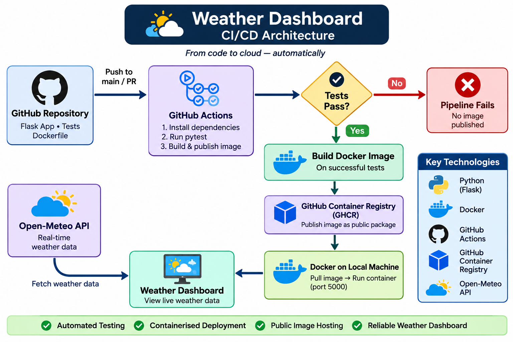

# Weather Dashboard — CI/CD with Docker and GitHub Actions

A containerized Flask weather dashboard that retrieves live weather information for Akure, Nigeria, using the Open-Meteo API.

This project demonstrates automated testing, continuous integration, Docker containerization, production application serving with Gunicorn, and automated Docker image publishing to GitHub Container Registry (GHCR).


## Features

- Live weather data from Open-Meteo.
- Displays temperature, humidity and weather conditions.
- Handles API failures gracefully.
- Uses cached weather data when a refresh fails.
- Automated application tests with pytest.
- Containerized using Docker.
- Served using Gunicorn.
- Automated CI/CD pipeline with GitHub Actions.
- Automated Docker image publishing to GHCR.

## Technology Stack

- **Language:** Python
- **Web framework:** Flask
- **Testing:** pytest
- **Application server:** Gunicorn
- **Containerization:** Docker
- **CI/CD:** GitHub Actions
- **Container registry:** GitHub Container Registry
- **Weather API:** Open-Meteo

## Architecture

The diagram below illustrates the application's CI/CD pipeline, container publishing process, and runtime flow.



## Running Locally

Clone the repository:

```bash
git clone https://github.com/benitaadakeja/weather-dashboard.git
cd weather-dashboard
```

Create and activate a virtual environment:

```bash
python -m venv weather
source weather/bin/activate
```

Install dependencies:

```bash
pip install -r requirements.txt
```

Start the application:

```bash
python app.py
```

Open `http://localhost:5000` in your browser.

## Running with Docker

Build the image:

```bash
docker build -t weather-dashboard .
```

Run the container:

```bash
docker run --rm -p 5000:5000 weather-dashboard
```

Open `http://localhost:5000`.

## Pulling from GitHub Container Registry

The published image is available at:

`ghcr.io/benitaadakeja/weather-dashboard:latest`

Pull the image:

```bash
docker pull ghcr.io/benitaadakeja/weather-dashboard:latest
```

Run it:

```bash
docker run --rm -p 5000:5000 ghcr.io/benitaadakeja/weather-dashboard:latest
```

## Running Tests

```bash
python -m pytest -v
```

The test suite currently covers:

- Homepage availability.
- Dashboard title.
- Weather data rendering.
- API failure without cached data.
- Cached weather fallback.

## CI/CD Pipeline

The GitHub Actions workflow:

1. Checks out the repository.
2. Sets up Python.
3. Installs project dependencies.
4. Runs automated tests.
5. Builds the Docker image.
6. Publishes the image to GHCR after successful tests on pushes to `main`.

Pull requests run the test job but do not publish images.

## Future Improvements

- Deploy the containerized application to AWS.
- Improve deployment automation.
- Add application monitoring and logging.
- Expand automated test coverage.

## Author

**Benita Adakeja**

GitHub: https://github.com/benitaadakeja
